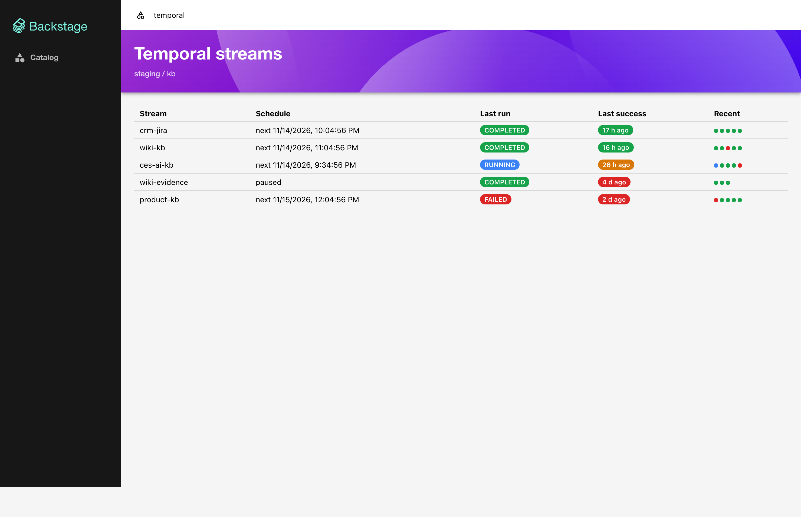
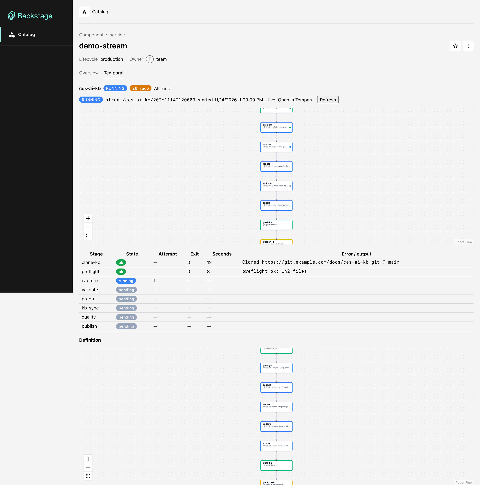
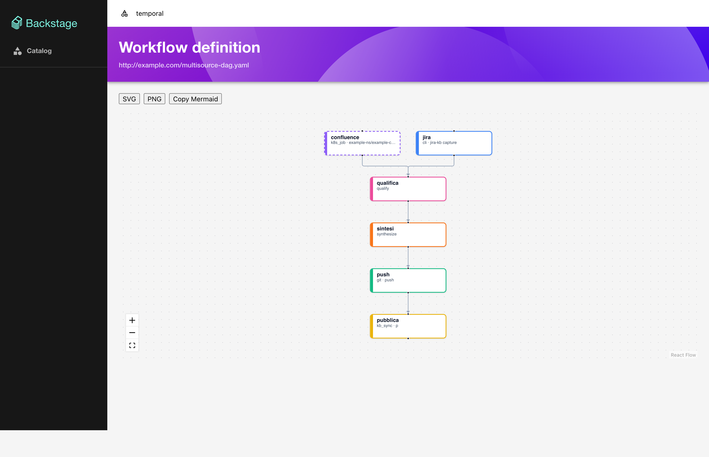

# backstage-plugin-temporal

Backstage plugins for [Temporal](https://temporal.io): high-level monitoring of
workflow "streams", and a visual diagram of YAML-defined workflows with the live
state of a run overlaid.

Status: early development. Not published. Read-only: the plugin never starts,
signals or changes workflows.

## What you get

- **Streams page** (`/temporal`): streams of a namespace, schedule, last run,
  freshness of the last success, recent statuses.
- **Stream page** (`/temporal/stream`): recent runs of a stream, and the selected
  run in detail: the definition with each stage's state, output and errors.
- **Entity tab and card**: for catalog entities with the `temporal.io/*`
  annotations below.
- **Definition page** (`/temporal/definition?location=<url>`): the diagram of a
  workflow definition stored in a repository.
- **Diagram export**: SVG, PNG and Mermaid source.

## Screenshots

| Streams page | Run detail (live state) |
|---|---|
|  |  |

| Completed run | Entity tab |
|---|---|
|  |  |

| Definition (single source) | Definition (parallel sources) |
|---|---|
|  |  |

## Layout

```
plugins/
  temporal-common/    shared types, workflow graph model, YAML parsers, layout, exports
  temporal-backend/   backend plugin: Temporal client and read-only REST API
  temporal/           frontend plugin: pages, entity tab and card, workflow diagram
packages/
  app/                example Backstage frontend for development
  backend/            example Backstage backend for development
```

## Configuration

Backend (`app-config.yaml`):

```yaml
temporal:
  clusters:
    - name: staging
      address: temporal-frontend.temporal.svc:7233
      namespaces: [kb]             # allow-list: other namespaces are never shown
      tls:
        enabled: false
      apiKey: ${TEMPORAL_API_KEY}  # Temporal Cloud; requires tls.enabled
      uiBaseUrl: https://temporal.example.com
      streamPrefix: 'stream/'      # workflow id prefix that identifies a stream
      workflowTypes: [StreamWorkflow]
  cache:
    ttlSeconds: 10
  redaction:
    maxTailLength: 2000
```

Permissions (permission framework):

- `temporal.read`: list streams and runs, read definitions and health.
- `temporal.run.read`: see task output and run parameters. Without it the run
  detail shows stages and states but no output.

Entity annotations:

| Annotation | Meaning |
|---|---|
| `temporal.io/cluster` | cluster name (default: the first configured) |
| `temporal.io/namespace` | namespace (default: the cluster's first namespace) |
| `temporal.io/stream` | stream name, the id prefix after `streamPrefix` |
| `temporal.io/definition-location` | URL of the YAML definition (optional) |

Definitions from a repository are read through Backstage's `UrlReader`, so only
hosts configured under `integrations` (or `backend.reading.allow`) can be read.

### Data converters

Stage states are matched to activities by the stage name in each activity's
input. This needs the payloads to be plain JSON. If a custom data converter
encodes them differently, the plugin falls back to matching by position, which is
correct only for sequential streams, and marks the run as
`degraded: positional-association`.

## Local preview

Read a real Temporal namespace through a port-forward, with an explicit kubectl
context:

```sh
kubectl --context <your-context> -n temporal port-forward svc/temporal-frontend 17233:7233
```

Put the cluster in `app-config.local.yaml` (git-ignored), with a static token
for the backend API, and start the apps:

```sh
export TEMPORAL_DEV_TOKEN=$(openssl rand -hex 16)
yarn install
yarn start   # or start packages/backend and packages/app separately
```

To try the definition page without a repository, serve the fixtures and allow
that host to be read:

```sh
cd plugins/temporal-common/src/__fixtures__/kbflow && python3 -m http.server 8001
```

```yaml
# app-config.local.yaml
backend:
  reading:
    allow:
      - host: localhost:8001
```

Then open `http://localhost:3000/temporal/definition?location=http://localhost:8001/jira-kb.yaml`.

Tests:

```sh
yarn test                                  # unit tests
TEMPORAL_TEST_ADDRESS=localhost:17233 TEMPORAL_TEST_NAMESPACE=kb \
  yarn workspace @acarmisc/backstage-plugin-temporal-backend test staging   # read-only, against the port-forward
```

## Development

```sh
yarn tsc
yarn test
yarn build
```

Requires Node 22 or 24.

## License

MIT. See [LICENSE](./LICENSE).

## Releasing

Publishing is done by GitHub Actions when a tag is pushed (`.github/workflows/publish.yaml`):

```sh
git tag temporal-common@0.1.0   # publish first when temporal-common changed
git push origin temporal-common@0.1.0
git tag temporal-backend@0.1.0
git push origin temporal-backend@0.1.0
git tag temporal@0.1.0
git push origin temporal@0.1.0
```

The tag's version must match the `version` of the package it names. The job
publishes with `yarn npm publish --provenance` and needs an `NPM_TOKEN` secret.
