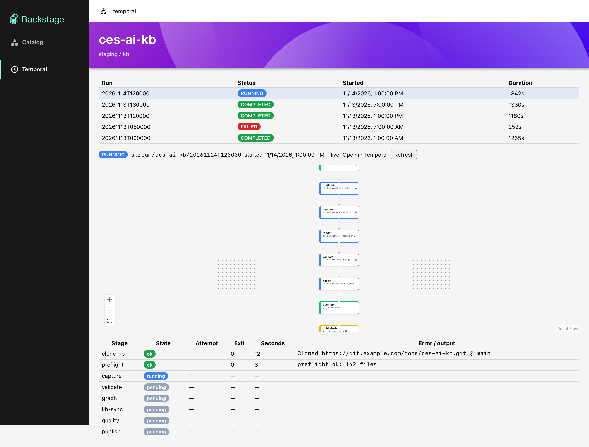
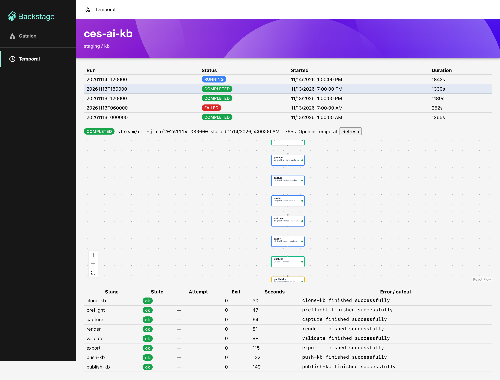
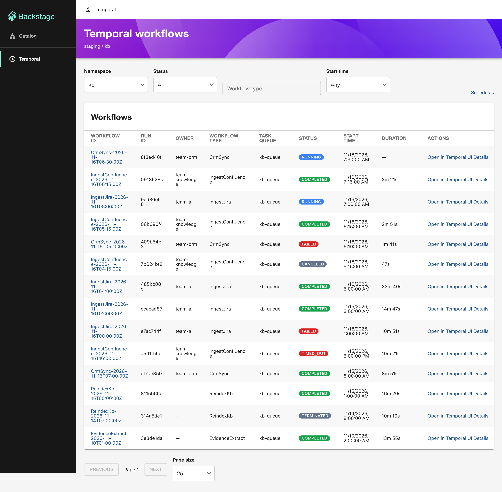
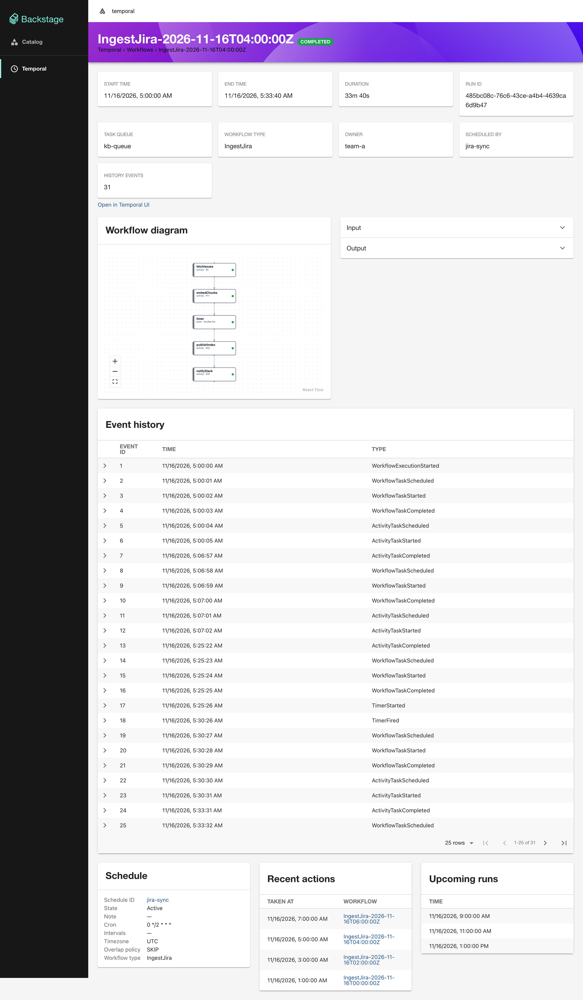
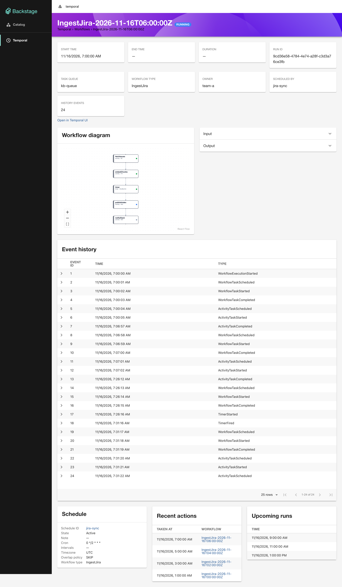
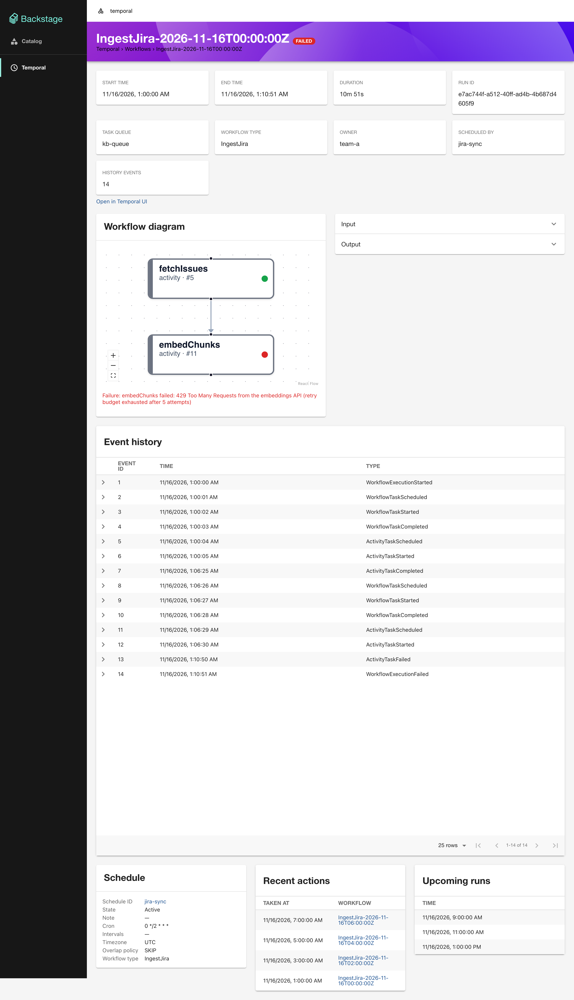
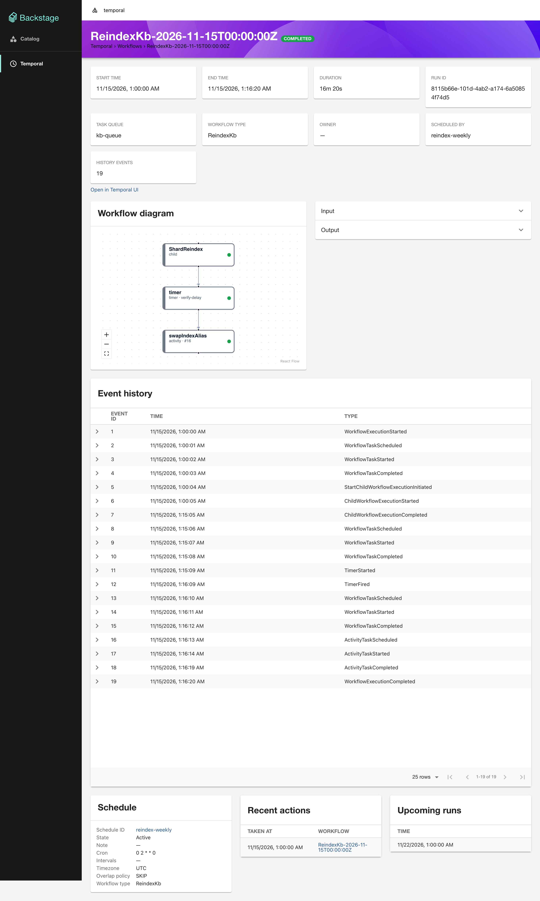
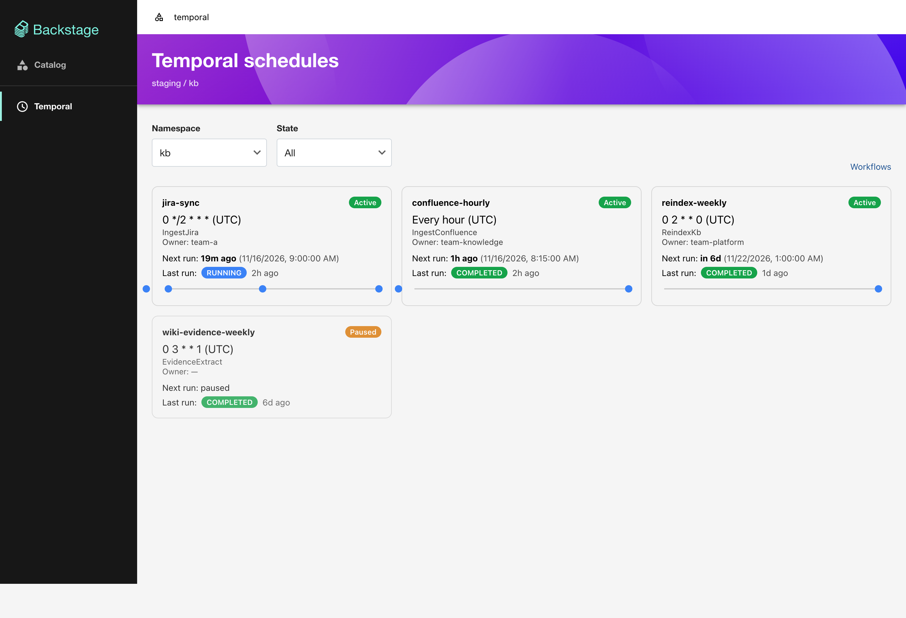
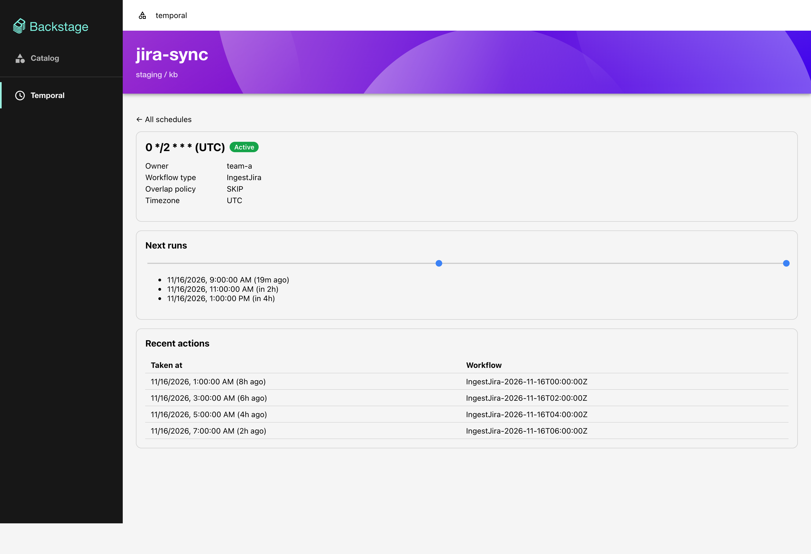

# backstage-plugin-temporal

Backstage plugins for [Temporal](https://temporal.io): high-level monitoring of
workflow "streams", and a visual diagram of YAML-defined workflows with the live
state of a run overlaid.

Published on npm. Read-only: the plugin never starts,
signals or changes workflows.

## Installation

Install `@acarmisc/backstage-plugin-temporal` in the app and
`@acarmisc/backstage-plugin-temporal-backend` in the backend. Install their
Backstage peer dependencies at compatible versions in the respective workspaces.
The new frontend system and Backstage 1.56.2 have been tested.

Add `temporalPlugin` from the frontend package to `createApp({ features: [...] })`,
and register the backend with:

```ts
backend.add(import('@acarmisc/backstage-plugin-temporal-backend'));
```

The main page is discoverable by new-frontend navigation (`nav.rest()`); custom
sidebars can select `page:temporal`. API access is still controlled by permissions.

The backend installs `@temporalio/client` as a dependency (`^1.13.0`); its exact
version is selected by the host lockfile. Connectivity has been verified against
Temporal OSS server 1.32.2, Helm chart 1.8.0 and PostgreSQL (`postgres12` schema);
other server/client combinations have not been validated here.

## What you get

- **Streams page** (`/temporal`): streams of a namespace, schedule, last run,
  freshness of the last success, recent statuses.
- **Stream page** (`/temporal/stream`): recent runs of a stream, and the selected
  run in detail: the definition with each stage's state, output and errors.
- **Workflows page** (`/temporal/workflows`): every workflow of an allowed
  namespace, filtered by status, workflow type and start time, with paging.
  Sorting by start time or duration applies to the loaded page only.
- **Workflow page** (`/temporal/workflow`): one execution: metadata, a diagram
  of its activities and timers from its history (colours show completed,
  running, pending, failed and cancelled steps), the failure message, input and
  result in a JSON viewer, the expandable event history and, for scheduled runs,
  the schedule's spec and next runs. Input, result, memo and history payloads
  need `temporal.run.read`; sensitive keys are masked.
- **Schedules page** (`/temporal/schedules`): the namespace's Temporal Schedules
  as cards, active or paused, with cadence, next runs and last run. Filterable
  by state.
- **Schedule page** (`/temporal/schedule`): one schedule: cadence, timezone,
  overlap policy, upcoming runs and the workflows it recently started.
- **Entity tab and card**: for catalog entities with the `temporal.io/*`
  annotations below.
- **Definition page** (`/temporal/definition?location=<url>`): the diagram of a
  workflow definition stored in a repository.
- **Diagram export**: SVG, PNG and Mermaid source.

## Screenshots

| Streams page | Run detail (live state) |
|---|---|
|  |  |

| Completed run | Entity tab |
|---|---|
|  |  |

| Definition (single source) | Definition (parallel sources) |
|---|---|
|  |  |

| Workflow browser | Workflow detail (completed, scheduled) |
|---|---|
|  |  |

| Running workflow (pending activity, timer) | Failed workflow (activity error) |
|---|---|
|  |  |

| Completed reindex (timer, activity) | Schedules |
|---|---|
|  |  |

| Schedule detail |
|---|
|  |

The screenshots use fake data from `scripts/fake-data/`. Regenerate them with:

```sh
yarn build                                          # builds temporal-common, which the generator imports
node scripts/gen-fake-data.mjs                      # writes scripts/fake-data/*.json (committed)
TEMPORAL_DEV_TOKEN=dev-screenshot-token yarn start  # frontend :3000, backend :7007
PLAYWRIGHT_MODULE=<path to playwright> node scripts/capture-screenshots.mjs
```

`PLAYWRIGHT_MODULE` defaults to `playwright`; `CHROME_PATH` defaults to the macOS
Google Chrome app. Times in the data hang off the anchor in
`gen-fake-data.mjs` (`FAKE_NOW` overrides it), so labels such as "in 3h" are
right near that time. Regenerate with a new `FAKE_NOW` once they drift.

## Layout

```
plugins/
  temporal-common/    shared types, workflow graph model, YAML parsers, layout, exports
  temporal-backend/   backend plugin: Temporal client and read-only REST API
  temporal/           frontend plugin: pages, entity tab and card, workflow diagram
packages/
  app/                example Backstage frontend for development
  backend/            example Backstage backend for development
```

## Configuration

Backend (`app-config.yaml`):

```yaml
temporal:
  clusters:
    - name: staging
      address: temporal-frontend.temporal.svc:7233
      namespaces: [kb]             # allow-list: other namespaces are never shown
      tls:
        enabled: false
        # serverName: temporal.example.com  # optional TLS SNI override
        # caData: ${TEMPORAL_CA_PEM}        # optional PEM-encoded root CA
      apiKey: ${TEMPORAL_API_KEY}  # Temporal Cloud; requires tls.enabled
      uiBaseUrl: https://temporal.example.com
      streamPrefix: 'stream/'      # workflow id prefix that identifies a stream
      workflowTypes: [StreamWorkflow]
  cache:
    ttlSeconds: 10
  redaction:
    maxTailLength: 2000
```

When using custom TLS options, set `tls.enabled: true`. With default-deny
NetworkPolicies, allow backend egress to the Temporal gRPC port (usually 7233).
The browser uses `uiBaseUrl` only for links to the Temporal UI; Temporal gRPC
connections and credentials stay in the backend, so no Temporal CSP entry is needed.

Permissions (permission framework):

- `temporal.read`: list streams and runs, read definitions and health.
- `temporal.run.read`: see task output and run parameters. Without it the run
  detail shows stages and states but no output.

The backend registers `temporalPermissions` with Backstage. With RBAC enabled,
explicitly grant `temporal.read`; otherwise users see 403s.
For example, in the Backstage RBAC plugin's `policies.csv`:

```csv
p, role:default/temporal-reader, temporal.read, read, allow
```

Grant `temporal.run.read` separately if that role may see output and parameters.
The navigation entry is not automatically hidden when permission is denied.

Entity annotations:

| Annotation | Meaning |
|---|---|
| `temporal.io/cluster` | cluster name (default: the first configured) |
| `temporal.io/namespace` | namespace (default: the cluster's first namespace) |
| `temporal.io/stream` | stream name, the id prefix after `streamPrefix` |
| `temporal.io/definition-location` | URL of the YAML definition (optional) |

For example:

```yaml
apiVersion: backstage.io/v1alpha1
kind: Component
metadata:
  name: crm-kb
  annotations:
    temporal.io/cluster: staging
    temporal.io/namespace: kb
    temporal.io/stream: crm-jira
    temporal.io/definition-location: https://example.com/workflows/crm-jira.yaml
spec:
  type: service
  lifecycle: production
  owner: team-a
```

The stream name is the part after `streamPrefix`: with `stream/`, manual workflow
IDs can be `stream/crm-jira/20261114T102908` and scheduled action IDs can be
`stream/crm-jira-2026-11-15T03:00:00Z`. The tab and card require the stream
annotation; use the URL reader allow-list for the definition URL.

Definitions from a repository are read through Backstage's `UrlReader`, so only
hosts configured under `integrations` (or `backend.reading.allow`) can be read.

### Ownership

Streams, workflows and schedules show their Backstage owner, read from the catalog in
the browser (no extra backend endpoint). A catalog `Component` with the
`temporal.io/stream: <stream name>` annotation and a `spec.owner` makes that owner
appear in the **Owner** column of the Streams and Workflows pages, on schedule cards,
and in the workflow and schedule detail headers. Unowned items show `—`.

- Workflows match by id: `stream/<name>`, `stream/<name>/<timestamp>` and
  `stream/<name>-<timestamp>` all resolve to `<name>` (the longest matching stream name wins).
- Schedules match when the schedule id equals the stream name (best effort).
- `temporal.io/cluster` and `temporal.io/namespace` are not used for the lookup: if two
  entities claim the same stream name, the last one returned wins.
- The lookup fails soft: if the catalog call errors or is denied, nothing is shown and
  there is no error banner. The user needs permission to read the Components.

### Data converters

Stage states are matched to activities by the stage name in each activity's
input. This needs the payloads to be plain JSON. If a custom data converter
encodes them differently, the plugin falls back to matching by position, which is
correct only for sequential streams, and marks the run as
`degraded: positional-association`.

## Local preview

Read a real Temporal namespace through a port-forward, with an explicit kubectl
context:

```sh
kubectl --context <your-context> -n temporal port-forward svc/temporal-frontend 17233:7233
```

Put the cluster in `app-config.local.yaml` (git-ignored), with a static token
for the backend API, and start the apps:

```sh
export TEMPORAL_DEV_TOKEN=$(openssl rand -hex 16)
yarn install
yarn start   # or start packages/backend and packages/app separately
```

To try the definition page without a repository, serve the fixtures and allow
that host to be read:

```sh
cd plugins/temporal-common/src/__fixtures__/kbflow && python3 -m http.server 8001
```

```yaml
# app-config.local.yaml
backend:
  reading:
    allow:
      - host: localhost:8001
```

Then open `http://localhost:3000/temporal/definition?location=http://localhost:8001/jira-kb.yaml`.

Tests:

```sh
yarn test                                  # unit tests
TEMPORAL_TEST_ADDRESS=localhost:17233 TEMPORAL_TEST_NAMESPACE=kb \
  yarn workspace @acarmisc/backstage-plugin-temporal-backend test staging   # read-only, against the port-forward
```

## Development

```sh
yarn tsc
yarn test
yarn build
```

Requires Node 22 or 24.

## License

MIT. See [LICENSE](./LICENSE).

## Releasing

Publishing is done by GitHub Actions when a tag is pushed (`.github/workflows/publish.yaml`):

```sh
git tag temporal-common@0.2.0   # publish first when temporal-common changed
git push origin temporal-common@0.2.0
git tag temporal-backend@0.2.0
git push origin temporal-backend@0.2.0
git tag temporal@0.2.0
git push origin temporal@0.2.0
```

The tag's version must match the `version` of the package it names. The job
publishes with `yarn npm publish --provenance` and needs an `NPM_TOKEN` secret.
